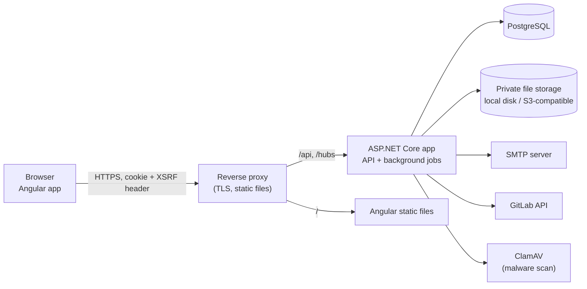
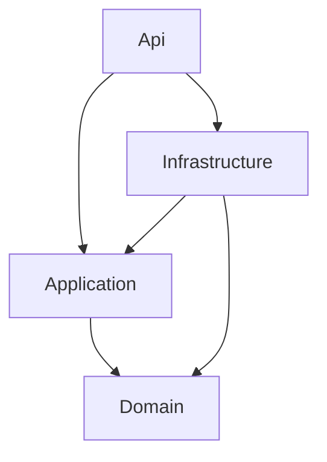
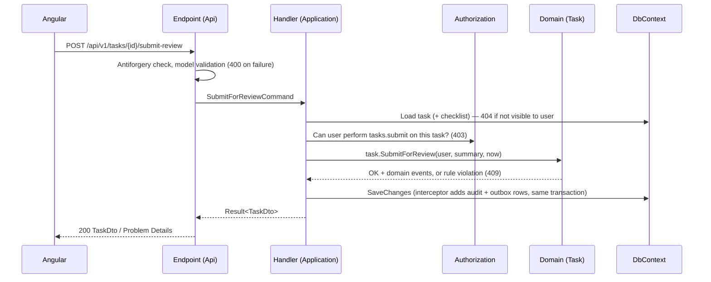

# Architecture

Status: **Approved (Phase 2, 2026-10-17)** — kept up to date as phases are implemented
Last updated: 2026-10-17

This document explains how the application is structured and why. It implements the requirements in [requirements.md](requirements.md).

## 1. Summary

- **One deployable backend** (a *modular monolith*): one ASP.NET Core application that contains all modules, with clear folders and rules between modules. This is simpler to build, test, deploy and debug than microservices, and the expected scale (~500 users, assumption A9) does not need more.
- **One Angular single-page app**, served from the same site as the API, so authentication can use a secure HttpOnly cookie instead of tokens stored in the browser.
- **One PostgreSQL database**, with one PostgreSQL *schema* per module (for example `tasks`, `time`, `audit`) so data ownership is visible.
- **Background jobs** run inside the same application as hosted services, and can be moved to a separate worker process later without code changes to the modules.



## 2. Verified versions

Checked on 2026-10-17 against nuget.org, npmjs.com and Microsoft's .NET release index. Exact patch versions are pinned when the projects are created in Phase 3.

| Component | Version | Notes |
|---|---|---|
| .NET SDK / ASP.NET Core | 10.0.x (10.0.13 current) | LTS, supported until 2028-11-14. .NET 11 is still a release candidate, so it is not used. |
| EF Core | 10.0.x | Same major as .NET. |
| Npgsql.EntityFrameworkCore.PostgreSQL | 10.0.x | Matches EF Core 10. |
| EFCore.NamingConventions | 10.0.x | snake_case table/column names. Depends on EF Core `[10.0.1, 11.0.0)` — compatible. |
| PostgreSQL | 18 | Ubuntu 26.04 ships 18; CI uses `postgres:18-alpine`. |
| Angular / Angular Material | 22.2.x | Requires Node `^22.22.3 \|\| ^24.15.0 \|\| >=26`. The project pins Node 24.22.0 LTS in `frontend/.nvmrc`. |
| Angular unit tests | Vitest (Angular's default runner) | |
| End-to-end tests | Playwright 1.6x | |
| Backend tests | xUnit v3 4.x on Microsoft.Testing.Platform, Testcontainers.PostgreSql 4.x, Microsoft.AspNetCore.Mvc.Testing 10 | `global.json` selects the Microsoft.Testing.Platform runner for `dotnet test`. |
| Email | MailKit 4.x | |
| S3-compatible storage | AWSSDK.S3 4.x | Production option. |
| MFA (TOTP) | ASP.NET Core Identity built-in authenticator support | No extra package. |
| Telemetry | OpenTelemetry .NET 1.x | Added when observability is wired up (Phase 12). |
| Fonts | `@fontsource/roboto` (self-hosted) | No requests to Google Fonts, so the CSP can stay `'self'`. Icons will be SVGs, not an icon font. |

**Libraries deliberately not used:**

| Library | Reason |
|---|---|
| MediatR, AutoMapper | Now commercially licensed, and unnecessary: handlers are plain classes injected directly; mapping is explicit code that is easy to read and test. |
| Hangfire / Quartz | Our jobs are simple periodic tasks and an outbox; `BackgroundService` + PostgreSQL row locking is enough. |
| Serilog | Built-in `ILogger` with the JSON console formatter + OpenTelemetry covers structured logging. Fewer dependencies. |
| Repository-per-entity layer | EF Core's `DbContext` already is a unit of work and repository; another layer adds code without benefit. |

## 3. Backend solution layout

```
TaskManagement.slnx
src/
  TaskManagement.Domain/          Entities, value objects, enums, workflow rules (no framework dependencies except .NET)
  TaskManagement.Application/     Use cases per module, DTOs, validation, authorization rules, interfaces for infrastructure
  TaskManagement.Infrastructure/  EF Core DbContext + migrations, Identity stores, file storage, email, GitLab client,
                                  malware scanner client, Data Protection, background job implementations
  TaskManagement.Api/             Program.cs, HTTP endpoints, auth/antiforgery setup, middleware, OpenAPI, SignalR hub,
                                  hosting of background jobs
tests/
  TaskManagement.Domain.Tests/        Unit tests: workflow state machine, rules
  TaskManagement.Application.Tests/   Unit tests: handlers with in-memory fakes where useful (created with the first handlers, Phase 4)
  TaskManagement.IntegrationTests/    API + real PostgreSQL (Testcontainers): authorization, workflows, migrations
  TaskManagement.ArchitectureTests/   Enforce layer and module dependency rules
frontend/                           Angular workspace (see §7)
e2e/                                Playwright tests (created in Phase 4)
deploy/db/                          Database role/grant script
docs/
```

**Dependency direction (enforced by architecture tests):**



- Domain depends on nothing.
- Application depends only on Domain (and small Microsoft abstractions such as `ILogger`, `TimeProvider`). It defines interfaces like `IFileStorage`, `IEmailSender`, `IGitLabClient`.
- Infrastructure implements those interfaces.
- Api wires everything together and contains no business rules.

**Why four projects and not more?** Four projects give a real compile-time barrier between business rules and technical details without creating one project per module (which would be ~40 projects). Module boundaries inside each project are folders, enforced by architecture tests (§4).

## 4. Modules

Each module is a folder with the same name in Domain, Application, Infrastructure and Api.

| Module | Responsibility | DB schema |
|---|---|---|
| `Identity` | Sign-in, password reset, MFA, members | `identity` |
| `Access` | Roles, permissions, authorization handlers | `access` |
| `Settings` | Global settings with typed access and caching | `settings` |
| `Projects` | Projects and project memberships | `projects` |
| `Tasks` | Tasks, assignments, workflow, algorithms, checklists, reviews, revisions, approval requests, delay reports, comments | `tasks` |
| `TimeTracking` | Work sessions, adjustments, allocated-hour checks | `time` |
| `Notifications` | Outbox, in-app notifications, email delivery, preferences, SignalR | `notifications` |
| `Attachments` | Upload, scan, storage, authorized download | `files` |
| `GitLab` | Connections, project links, issue import and sync | `gitlab` |
| `Reporting` | Dashboards and reports (read-only queries) | (reads others) |
| `Audit` | Audit log writing and search | `audit` |

**Rules between modules:**

1. A module changes only its own tables.
2. A module may *read* another module's data through that module's query service (for example `IProjectAccessQueries`), not by touching its entities directly. Reporting is the exception: it uses read-only queries across schemas for performance.
3. Side effects in other modules happen through **domain events** collected during a request (for example `TaskAssigned`) and handled in the same transaction (audit, notification outbox) — not through direct calls back and forth.
4. Tasks and TimeTracking are closely linked (start/stop changes both). They share one transaction; TimeTracking exposes `IWorkSessionService` which Tasks calls during workflow actions.

**Why one DbContext for all modules?** Many actions must change several modules' data atomically: starting work updates the task, inserts a session, writes an audit row and an outbox row. One DbContext with one transaction is the simplest reliable way. Separate schemas still keep ownership clear. If a module is ever split out, its schema can move with it.

## 5. Request flow (backend)



Key conventions:

- **Endpoints**: Minimal API endpoint groups, one file per module area (for example `TaskWorkflowEndpoints.cs`). Endpoints only translate HTTP ↔ commands. This avoids giant controllers.
- **Handlers**: one class per use case (`AssignTaskHandler`, `StartWorkHandler`), registered in DI. This avoids giant service classes.
- **Validation**: input shape (required fields, lengths, formats) is validated at the endpoint with .NET 10's built-in Minimal API validation (`Microsoft.Extensions.Validation`, Data Annotations). Business rules (state, ownership, checklist) live in the Domain and return typed errors.
- **Results, not exceptions, for expected failures**: handlers return `Result<T>` with an error code (`NotFound`, `Forbidden`, `Conflict`, `Validation`), mapped to Problem Details in one place. Exceptions are for unexpected failures only.
- **Authorization**: ASP.NET Core resource-based authorization. A `PermissionAuthorizationHandler` checks permission + scope (Global / Project / Own) using a cached, per-user permission set. Separation-of-duty rules are checked in the domain method too (defense in depth).
- **Time**: all business code uses the injected `TimeProvider`, so tests can control time. In production it is the server's UTC clock (NTP-synchronized). The client never supplies timestamps.
- **Async**: all I/O is async and accepts `CancellationToken`.
- **Concurrency**: optimistic concurrency with PostgreSQL's `xmin` system column; conflicts return 409.

## 6. Domain model and workflow

- `ProjectTask` (named to avoid clashing with `System.Threading.Tasks.Task`) is the aggregate root for the workflow. Its methods (`Assign`, `SubmitAlgorithm`, `Start`, `Pause`, ..., `Close`) are the **only** way to change its status. Each method checks the allowed transitions table from [task-workflow.md](task-workflow.md) §3 and raises domain events.
- The transition table is defined once in `TaskWorkflow` (a static table of `(state, action) → target state`) and unit-tested exhaustively: every state × every action.
- `WorkSession`, `ApprovalRequest`, `AlgorithmSubmission`, `ReviewSubmission`, `TaskChecklistItem`, `TaskAssignment` are separate entities linked to the task.
- History tables are append-only.

## 7. Frontend (Angular)

```
frontend/src/app/
  core/          auth service & guards, HTTP interceptors (XSRF, error → toast, 401 → sign-in), permission service, layout
  shared/        reusable UI components, pipes (time zone, durations), form helpers
  features/
    auth/        sign-in, forgot/reset password, MFA
    dashboard/
    projects/
    tasks/       list, detail, workflow actions, checklist, algorithm, review, requests
    time/        active session bar, timesheets
    notifications/
    reports/
    admin/       members, roles, settings, checklist templates, GitLab, audit
```

- **Standalone components, signals, and lazy-loaded routes** per feature (current Angular style; no NgModules).
- **Angular Material** for accessible components (WCAG 2.2 AA target).
- **Typed API client** generated from the backend's OpenAPI document during the build, so the frontend and backend contracts cannot drift silently.
- **Permissions in the UI** come from `/api/v1/me` and per-project permission lists, used only to show/hide controls.
- **No secrets in the frontend.** Configuration contains only the API base path.
- **Strict TypeScript** and Angular strict templates enabled.

## 8. Background jobs

Implemented as `BackgroundService` classes using `PeriodicTimer`. Safe with more than one app instance: each job takes a PostgreSQL advisory lock or claims rows with `SELECT ... FOR UPDATE SKIP LOCKED`.

| Job | Interval | Purpose |
|---|---|---|
| Outbox dispatcher | 2 s | Turns outbox messages into in-app notifications and email deliveries; pushes SignalR updates. |
| Email sender | 10 s | Sends pending emails with retry/backoff. |
| Session monitor | 1 min | Auto-closes over-long sessions; sends 80 %/100 % allocated-hour notifications. |
| Deadline monitor | 15 min | Due-soon and overdue flags/notifications. |
| GitLab sync | 15 min (setting) | Pulls issue changes for linked projects. |
| Malware scan | 10 s | Scans pending uploads with ClamAV; marks clean/infected. |
| Cleanup | daily | Expired reset tokens, idempotency keys, orphaned partial uploads. |

All jobs log start/end/failures and expose last-run status to the Admin health page.

## 9. Real-time notifications

A SignalR hub (`/hubs/notifications`) authenticated by the same cookie pushes "new notification" messages to the signed-in user. If the connection fails, Angular polls the unread count every 60 s. With more than one app instance, a backplane (Redis or PostgreSQL-based) is needed — not required at the expected scale (one instance + database is enough).

## 10. Cross-cutting

| Concern | Approach |
|---|---|
| Errors | One exception handler + `Result` mapping → RFC 9457 Problem Details with `traceId` and an application error `code`. |
| Logging | `ILogger` structured logging, JSON in test/production; correlation ID = W3C trace ID; secrets never logged. |
| Configuration | `appsettings.json` (non-secret defaults) + environment variables / secret store. User Secrets in development. |
| Health | `/health/live`, `/health/ready` (DB, storage, SMTP). Details only for Admins. |
| OpenAPI | Built-in `Microsoft.AspNetCore.OpenApi` document at `/openapi/v1.json` (development and test only; disabled in production by default). |
| Rate limiting | Built-in ASP.NET Core rate limiter on auth and upload endpoints. |

## 11. Decisions log

| # | Decision | Why |
|---|---|---|
| D1 | Modular monolith, 4 projects, module folders | Simple to run; clear boundaries; can split later. |
| D2 | One DbContext, schema per module | Atomic multi-module changes; visible ownership. |
| D3 | Cookie auth, same-site SPA (no JWT in browser) | Tokens in browser storage can be stolen by XSS; HttpOnly cookies cannot be read by scripts. |
| D4 | Custom role/permission tables instead of Identity roles | Requirement for configurable permissions with project/own scopes. |
| D5 | Application `TimeProvider` (server UTC) rather than database `now()` | Same "server-side time" guarantee, and makes time rules testable. |
| D6 | Minimal APIs + handler classes, no MediatR/AutoMapper | Less magic, no commercial-licence dependency, small focused files. |
| D7 | Outbox for notifications | Notifications never lost and never roll back business changes. |
| D8 | GitHub + GitHub Actions for source control and CI | Decision Q1. GitLab is used only as an integration source. |
