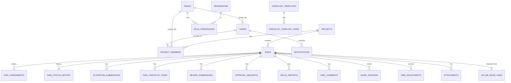

# Database Design

Status: **Approved (Phase 2, 2026-10-17)** — kept up to date as phases are implemented
Last updated: 2026-10-17

PostgreSQL 18, accessed through EF Core 10 with Npgsql. EF Core's migration history is kept in `ops.__ef_migrations_history`. All schema changes are EF Core migrations (NFR-MNT-02).

## 1. Conventions

| Topic | Convention | Why |
|---|---|---|
| Names | `snake_case` tables and columns (EFCore.NamingConventions), plural table names | PostgreSQL-friendly; no quoting needed in SQL. |
| Schemas | One per module: `identity`, `access`, `settings`, `projects`, `tasks`, `time`, `notifications`, `files`, `gitlab`, `audit`, `ops` | Shows which module owns each table. |
| Primary keys | `uuid`, generated in the app as UUID v7 (`Guid.CreateVersion7()`) | Not guessable like 1, 2, 3; time-ordered so indexes stay efficient. `audit_logs` uses `bigint` identity for speed. |
| Time | `timestamptz`, always UTC. Dates without time (due date) are `date`. | No time-zone ambiguity. |
| Enums | Stored as `text` with a `CHECK` constraint | Readable in SQL and reports; safe to reorder in code. |
| Durations | Stored as integer seconds (`duration_seconds`) or minutes for allocations | Exact arithmetic, easy SUM. |
| Concurrency | PostgreSQL `xmin` mapped as a concurrency token on editable tables | No extra column needed; detects lost updates. |
| Deletion | Soft delete (`deleted_at`) or status-based (deactivated, cancelled) for business data | Preserve history (mandatory rule). |
| History | Append-only history tables (no UPDATE/DELETE from app code) | Preserve revision/assignment/time/approval history. |
| Foreign keys | Always declared; `ON DELETE RESTRICT` by default | Prevent accidental loss of history. |
| Text limits | Explicit max lengths on short text; `text` for Markdown bodies with app-level limit (e.g. 50 000 chars) | Prevent abuse. |

## 2. Entity-relationship overview



## 3. Tables

Column lists show the important columns; every editable table also has `created_at`, `created_by`, `updated_at`, `updated_by` unless stated.

### 3.1 `identity`

**`users`** — ASP.NET Core Identity user, extended.

| Column | Type | Notes |
|---|---|---|
| id | uuid PK | |
| email, normalized_email | varchar(256) | `normalized_email` unique |
| user_name, normalized_user_name | varchar(256) | = email |
| password_hash | text, null | Identity PBKDF2 hash. Null until the member sets a password. |
| security_stamp | text | Changes on password/role change → other sessions signed out (cookie re-validation every 1 min). |
| concurrency_stamp | text | Identity standard |
| lockout_end, lockout_enabled, access_failed_count | | Lockout (FR-AUTH-05) |
| two_factor_enabled | bool | |
| full_name | varchar(200) | |
| time_zone | varchar(64) | IANA id, e.g. `Asia/Kolkata` |
| global_role_id | uuid FK → access.roles | |
| employee_code | varchar(50), null | unique when not null |
| is_active | bool | |
| deactivated_at, deactivated_by | | |
| last_sign_in_at | timestamptz | |

Identity tables used: `user_tokens` (stores the TOTP authenticator key — **encrypted** with Data Protection through a value converter), `user_logins` (empty now; kept for future SSO, Q13). Identity's role tables are **not** used (decision D4).

**`password_tokens`** — reset and "set your password" tokens (FR-AUTH-07, FR-AUTH-09).

| Column | Type | Notes |
|---|---|---|
| id | uuid PK | |
| user_id | uuid FK | |
| purpose | text | `Reset` / `Invite` |
| token_hash | bytea | SHA-256 of a 32-byte random token. The raw token exists only in the email. |
| expires_at | timestamptz | |
| used_at | timestamptz null | Single use |
| revoked_at | timestamptz null | Set when a newer token is issued or the password changes |
| requested_ip | inet | |

Index: unique (`token_hash`); (`user_id`) where `used_at IS NULL AND revoked_at IS NULL`.

### 3.2 `access`

**`roles`**: id, name (unique), description, is_system (seed roles cannot be deleted), applies_to (`Global` / `Project` / `Both`).

**`permissions`**: code (PK, e.g. `tasks.create`), module, description. Rows are seeded from code; Admins cannot invent permission codes (only assign them).

**`role_permissions`**: role_id, permission_code, scope (`Global` / `Project` / `Own`). PK (role_id, permission_code).

### 3.3 `settings`

**`global_settings`**: key (PK, e.g. `auth.lockout.maxFailedAttempts`), value (jsonb), updated_at, updated_by. Typed settings classes in the app validate values; unknown keys rejected.

### 3.4 `projects`

**`projects`**

| Column | Type | Notes |
|---|---|---|
| id | uuid PK | |
| key | varchar(10) | unique, upper-case letters/digits, e.g. `TMA` |
| name | varchar(200) | |
| description | text | Markdown |
| status | text | `Active`, `OnHold`, `Completed`, `Archived` |
| start_date, target_end_date | date | |
| algorithm_required_default | bool | |
| close_on_approval | bool | Q2 option |
| default_checklist_template_id | uuid null | |
| next_task_number | int | Incremented under row lock when a task is created |
| xmin | concurrency | |

**`project_members`**: id, project_id, user_id, project_role_id (FK roles), added_at, added_by, removed_at, removed_by.
Unique (project_id, user_id) where `removed_at IS NULL`. Membership history is kept by never deleting rows.

### 3.5 `tasks`

**`tasks`**

| Column | Type | Notes |
|---|---|---|
| id | uuid PK | |
| project_id | uuid FK, not null | Mandatory rule: task belongs to a project |
| number | int | unique (project_id, number); key shown as `{project.key}-{number}` |
| title | varchar(300) | |
| description | text | Markdown (sanitized on render) |
| type, priority, status | text + CHECK | statuses per task-workflow.md |
| assignee_id | uuid null FK users | current assignee |
| start_date | date null | |
| due_date | date | current due date |
| original_due_date | date null | due date at first assignment |
| allocated_minutes | int null | null = not estimated |
| algorithm_required | bool | |
| algorithm_approved_submission_id | uuid null | currently valid approval |
| current_revision | int default 0 | |
| approved_revision | int null | revision approved by TL (closure check) |
| warn_notified_revision, limit_notified_revision | int null | Allocated-hour notifications sent once per revision (FR-TIME-06/07) |
| is_overdue | bool | flag |
| gitlab_issue_closed | bool | flag |
| cancel_reason | text null | |
| closed_at, closed_by | | |
| xmin | concurrency | |

Indexes: (project_id, status); (assignee_id, status); (due_date) where status not in (`Approved`,`Closed`,`Cancelled`); GIN trigram on title for search (`pg_trgm`).

**`task_status_history`** (append-only): id, task_id, revision, from_status, to_status, action, actor_id, comment, occurred_at.

**`task_assignments`** (append-only): id, task_id, from_user_id (null on first), to_user_id, kind (`Initial` / `Reassignment`), reason, assigned_by, approval_request_id (null for Initial), occurred_at.

**`algorithm_submissions`**: id, task_id, revision, version (1, 2, …), content (text), submitted_by, submitted_at, decision (`Pending` / `Approved` / `Rejected`), decided_by, decided_at, decision_comment.
Unique (task_id, version). Content is immutable after insert (enforced in code; no update endpoint).

**`checklist_templates`**: id, project_id (null = global), name, is_active.
**`checklist_template_items`**: id, template_id, sort_order, text, is_mandatory.

**`task_checklist_items`**: id, task_id, source_template_item_id (null for task-specific), sort_order, text, is_mandatory, is_completed, completed_by, completed_at, note, reopened_in_revision, xmin.

**`review_submissions`**: id, task_id, revision, summary, submitted_by, submitted_at, decision (`Pending` / `Approved` / `RevisionRequested`), reviewed_by, reviewed_at, comment, algorithm_reapproval_required.

**`approval_requests`** — reassignment and deadline extension (one table, same lifecycle).

| Column | Type | Notes |
|---|---|---|
| id | uuid PK | |
| task_id | uuid FK | |
| type | text | `Reassignment` / `DeadlineExtension` |
| status | text | `Pending`, `Approved`, `Rejected`, `Withdrawn`, `AutoCancelled` |
| reason | text | required, min 10 chars |
| requested_by, requested_at | | |
| proposed_assignee_id | uuid null | Reassignment |
| algorithm_reapproval_required | bool | Reassignment |
| current_due_date, proposed_due_date, approved_due_date | date null | Extension |
| decided_by, decided_at, decision_comment | | |
| xmin | concurrency | |

Unique partial index: (task_id, type) where `status = 'Pending'` — one pending request of each type per task (FR-REV-06, FR-DL-04).

**`delay_reports`**: id, task_id, revision, category, description, reported_by, reported_at.

**`task_comments`**: id, task_id, author_id, body, created_at, edited_at, deleted_at. **`task_comment_edits`**: comment_id, previous_body, edited_at.

### 3.6 `time`

**`work_sessions`** (rows never deleted; only `ended_at`/`end_reason` set once)

| Column | Type | Notes |
|---|---|---|
| id | uuid PK | |
| task_id | uuid FK | |
| user_id | uuid FK | |
| revision | int | |
| started_at | timestamptz | server UTC |
| ended_at | timestamptz null | null = active |
| end_reason | text null | `Paused`, `Stopped`, `Submitted`, `AutoClosed`, `Reassigned`, `Cancelled`, `MemberDeactivated` |
| duration_seconds | int null | set when ended |

Constraints (FR-TIME-03 — enforced by the database):

```sql
CREATE UNIQUE INDEX ux_work_sessions_active_user ON time.work_sessions (user_id) WHERE ended_at IS NULL;
CREATE UNIQUE INDEX ux_work_sessions_active_task ON time.work_sessions (task_id) WHERE ended_at IS NULL;
ALTER TABLE time.work_sessions ADD CONSTRAINT ck_work_sessions_end_after_start
    CHECK (ended_at IS NULL OR ended_at >= started_at);
```

Index: (task_id, revision); (user_id, started_at) for timesheets.

**`time_adjustments`** (append-only): id, task_id, user_id (whose time), revision, minutes (±), reason, created_by, created_at.

### 3.7 `notifications`

**`outbox_messages`**: id, type, payload (jsonb), occurred_at, processed_at, attempts, next_attempt_at, last_error. Index on (processed_at, next_attempt_at).

**`notifications`**: id, recipient_id, type, title, body, link (relative app URL), project_id, task_id, created_at, read_at. Index (recipient_id, created_at desc); partial index (recipient_id) where `read_at IS NULL`.

**`email_deliveries`**: id, recipient_email, subject, body_html, body_text, status (`Pending`, `Sent`, `Failed`), attempts, next_attempt_at, last_error, sent_at. Reset-link emails are deleted (or body cleared) right after sending so tokens are not kept in the database.

**`notification_preferences`**: user_id, category, email_enabled. PK (user_id, category).

### 3.8 `files`

**`attachments`**

| Column | Type | Notes |
|---|---|---|
| id | uuid PK | |
| project_id, task_id | uuid | for authorization |
| owner_type, owner_id | text, uuid | `Task`, `Comment`, `Algorithm`, `Review` |
| original_file_name | varchar(255) | sanitized |
| content_type | varchar(100) | detected from file signature |
| size_bytes | bigint | |
| sha256 | bytea | integrity |
| storage_key | varchar(200) | random, no user input |
| scan_status | text | `Pending`, `Clean`, `Infected`, `Failed` |
| uploaded_by, uploaded_at | | |
| deleted_at, deleted_by | | soft delete |

### 3.9 `gitlab`

**`connections`**: id, name, base_url, token_ciphertext (bytea, Data Protection encrypted), token_hint (last 4 characters), status (`Healthy` / `Unhealthy`), last_checked_at, last_error. The token is never selected into API responses (separate query model).

**`project_links`**: id, project_id (unique), connection_id, gitlab_project_id (bigint), path_with_namespace, sync_enabled, last_synced_at.

**`issue_links`**: id, task_id (unique), connection_id, gitlab_project_id, issue_iid, issue_id, web_url, state, gitlab_updated_at, pending_changes (jsonb). Unique (connection_id, gitlab_project_id, issue_iid) — makes import idempotent (FR-IMP-04).

**`import_runs`**: id, project_id, started_by (null for scheduled), started_at, finished_at, created_count, updated_count, skipped_count, failed_count, errors (jsonb, no secrets).

**`webhook_secrets`** (optional webhook): project_link_id, secret_hash.

### 3.10 `audit`

**`audit_logs`**

| Column | Type | Notes |
|---|---|---|
| id | bigint identity PK | |
| occurred_at | timestamptz | |
| actor_id | uuid null | null = system job |
| actor_ip | inet null | |
| action | varchar(100) | e.g. `task.status_changed` |
| entity_type, entity_id | varchar(100), text | |
| project_id | uuid null | for project-scoped audit view |
| changes | jsonb | `{ "field": { "old": …, "new": … } }`, secrets excluded |
| correlation_id | varchar(64) | trace ID |

Indexes: (occurred_at); (entity_type, entity_id); (actor_id, occurred_at); (project_id, occurred_at).

**Append-only enforcement (FR-AUD-03):** the application connects as role `tma_app`, which has `INSERT, SELECT` on `audit.audit_logs` only. Migrations run as a separate owner role `tma_migrator`. Monthly partitioning can be added later if the table grows large.

### 3.11 `ops`

**`idempotency_keys`**: key, user_id, endpoint, request_hash, response_status, response_body (jsonb), created_at. PK (user_id, key). Cleaned after 24 hours.

**`job_runs`**: job_name, started_at, finished_at, succeeded, message — for the Admin health page.

**Data Protection keys** are **not** stored in this database. They live on a protected volume (or a cloud key store) and are encrypted at rest with a certificate/KMS, so a database dump alone cannot decrypt GitLab tokens or MFA keys.

## 4. Key computations

- **Time spent on a task** = `SUM(duration_seconds)` of ended sessions + (`now − started_at`) of an active session + `SUM(minutes) × 60` of adjustments.
- **Allocated-hour check** (session monitor job): tasks with an active session where `allocated_minutes IS NOT NULL` and time spent crosses 80 % / 100 % and `warn_notified_revision`/`limit_notified_revision` ≠ `current_revision`.
- **Task key**: `projects.next_task_number` is incremented with `UPDATE … RETURNING` inside the create transaction — no gaps from concurrent creates.

## 5. Database roles and access

| Role | Rights | Used by |
|---|---|---|
| `tma_migrator` | Owns schemas; DDL | Migration bundle in CI/CD |
| `tma_app` | SELECT/INSERT/UPDATE/DELETE on business tables; INSERT/SELECT only on `audit.audit_logs`; no DDL | Application |
| `tma_readonly` | SELECT | Optional reporting/BI |

## 6. Migrations

- Created with `dotnet ef migrations add`, reviewed in pull requests.
- Applied in test/production by an **EF Core migration bundle** run as a deployment step with `tma_migrator` — **never** automatically at app startup in production (avoids races between instances and keeps the app user without DDL rights).
- Development: applied automatically on startup for convenience.
- Seed data (permissions, system roles, default settings) applied by an idempotent seeder at startup — inserts missing rows, never overwrites Admin changes.
- Database and roles: `deploy/db/create-roles.sql` (Phase 3) creates `tma_migrator`, `tma_app` and default privileges, so every table the migrator creates is usable — but not alterable — by the app.
- First Admin: `dotnet TaskManagement.Api.dll create-admin --email ...` command sends an invite link (FR-ADM-03).

## 7. Backups and retention

- Production: daily full backup + WAL archiving for point-in-time recovery (NFR-REL-03). Attachment storage backed up/versioned separately.
- Retention: all business data kept (Q11). Audit logs at least 1 year (setting). Notifications older than 180 days and sent emails older than 30 days purged by the cleanup job.
