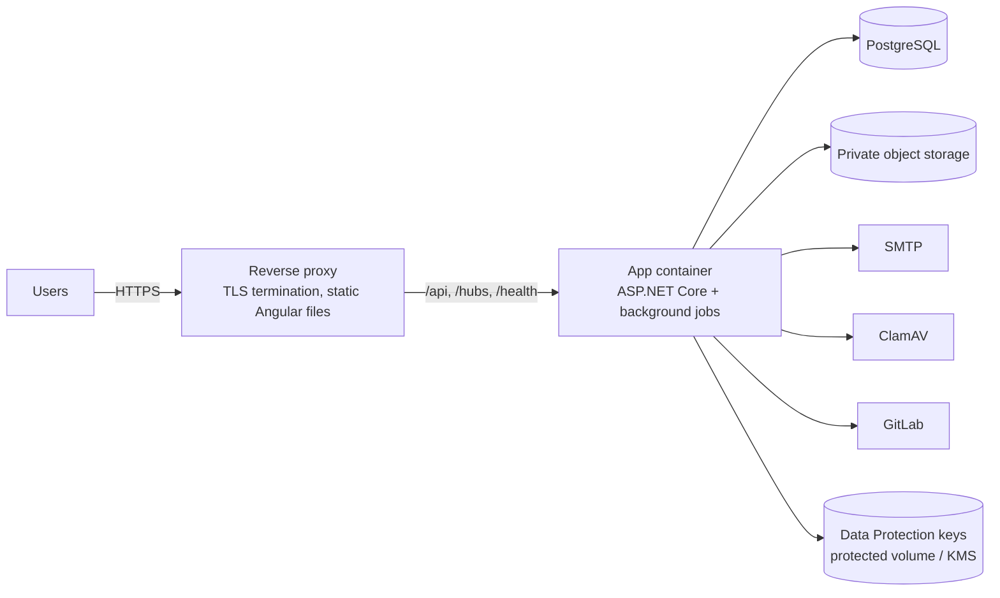

# Deployment

Status: **Phase 4 — local development and first-Admin setup documented; test/production details added in later phases**
Last updated: 2026-10-17

## 1. Environments

| | Development | Testing | Production |
|---|---|---|---|
| Purpose | Local coding | Shared QA, end-to-end tests, security scans | Real users |
| `ASPNETCORE_ENVIRONMENT` | Development | Testing | Production |
| Database | Local PostgreSQL 18 (Docker Compose or installed) | Dedicated PostgreSQL | Managed/HA PostgreSQL with PITR backups |
| Migrations | Auto-applied at startup | Migration bundle in CI/CD | Migration bundle in CI/CD (approval step) |
| Email | Mailpit (catches all mail) | Mailpit or a sandbox SMTP | Real SMTP provider |
| File storage | Local folder outside the repo | S3-compatible bucket (e.g. MinIO) | Private S3-compatible / Azure Blob bucket |
| Malware scan | Optional (ClamAV container) | ClamAV | ClamAV |
| OpenAPI UI | On | On | Off |
| HTTPS | Dev certificate | Yes | Yes + HSTS |
| Secrets | `dotnet user-secrets`, `.env` (git-ignored) | CI secrets / secret store | Secret store (e.g. cloud key vault) |
| Logging | Console (readable) | JSON + log collector | JSON + log collector + alerts |

## 2. Local development prerequisites

| Tool | Version | Notes |
|---|---|---|
| .NET SDK | 10.0.401 (pinned in `global.json`, newer 10.0.x feature bands allowed) | |
| Node.js | 24.22.0 LTS (`frontend/.nvmrc`); Angular 22 accepts `^22.22.3 \|\| ^24.15.0 \|\| >=26` | |
| PostgreSQL | 18 | Via `compose.yaml` or a local install |
| Docker + Compose | Recent | Optional locally; needed for `compose.yaml` and Testcontainers |

`compose.yaml` starts PostgreSQL 18 and Mailpit. MinIO and ClamAV are added with the attachments phase.

### Running locally

```bash
cp .env.example .env                 # then set POSTGRES_PASSWORD
docker compose up -d                 # or use your own PostgreSQL 18

# API (http://localhost:5080). The connection string is a secret: keep it out of the repo.
dotnet user-secrets --project src/TaskManagement.Api set "ConnectionStrings:Default" \
  "Host=localhost;Port=5432;Database=tma;Username=postgres;Password=<from .env>"
dotnet run --project src/TaskManagement.Api      # Development: applies migrations on startup

# Angular (http://localhost:4200, proxies /api, /hubs, /health, /openapi to the API)
cd frontend && npm ci && npm start
```

OpenAPI document (Development/Testing only): `http://localhost:5080/openapi/v1.json`.

**First Admin.** There is no registration page. Create the first Admin from the command line; the invite email (with the set-password link) is written to `storage/mail/` as an `.eml` file in Development:

```bash
dotnet run --project src/TaskManagement.Api -- create-admin --email you@example.com --name "Your Name" --time-zone Asia/Kolkata
```

Open the newest file in `storage/mail/`, follow the link, set a password and sign in at `http://localhost:4200`.

`npm` 11 blocks package install scripts unless approved. The four Angular build-tool packages that have them (`esbuild`, `lmdb`, `@parcel/watcher`, `msgpackr-extract`) are denied in `frontend/package.json` → `allowScripts`; their prebuilt binaries work without the scripts (verified by build and tests).

## 3. Production topology



- Containers: one image for the API (`mcr.microsoft.com/dotnet/aspnet:10.0`, non-root user), one static image or proxy config for Angular.
- One app instance is enough for the expected load; for more instances, add a SignalR backplane and shared Data Protection key storage (already external).
- Hosting provider: to be decided (Q14).

## 4. Release process (planned)

1. Merge to `main` → GitHub Actions builds, tests, scans, builds container images tagged with the commit SHA.
2. Deploy to Testing automatically; run migration bundle, then end-to-end tests and ZAP baseline.
3. Manual approval → deploy the same image to Production; run migration bundle with `tma_migrator`; roll out the app.
4. Rollback: redeploy previous image. Migrations are written to be backward compatible for one release (expand/contract), so the previous version still runs.

## 5. First-time setup (production)

1. Create database, roles and grants: `psql -h <host> -U postgres -v migrator_password=... -v app_password=... -f deploy/db/create-roles.sql`.
2. Configure secrets and settings (environment variables use `__` for `:`):

   | Setting | Purpose |
   |---|---|
   | `ConnectionStrings__Default` | `tma_app` connection string (secret) |
   | `App__PublicBaseUrl` | Public HTTPS address; used in email links |
   | `Email__SmtpHost`, `Email__SmtpPort`, `Email__SmtpSecurity`, `Email__FromAddress` | SMTP server |
   | `Email__SmtpUserName`, `Email__SmtpPassword` | SMTP credentials (secret) |
   | `DataProtection__KeysPath` | Protected volume for the keys that encrypt sign-in cookies; must survive restarts and be shared by all instances |
   | `DataProtection__CertificatePath`, `DataProtection__CertificatePassword` | Certificate that encrypts those keys at rest (password is a secret) |

3. Run migration bundle as `tma_migrator`; the app connects as `tma_app`.
4. Send the first Admin invite: `dotnet TaskManagement.Api.dll create-admin --email <email> --name "<full name>" [--time-zone <IANA id>]`. The link is emailed, never printed.

## 6. Backups

See [database-design.md](database-design.md) §7. Restore is tested at least once per quarter and before the first production release.
