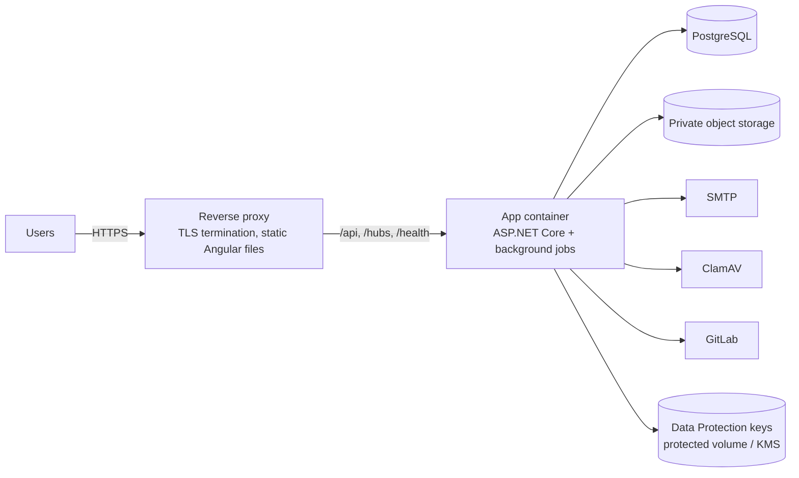

# Deployment

Status: **Phase 2 outline — details added as the application is built**
Last updated: 2026-10-17

## 1. Environments

| | Development | Testing | Production |
|---|---|---|---|
| Purpose | Local coding | Shared QA, end-to-end tests, security scans | Real users |
| `ASPNETCORE_ENVIRONMENT` | Development | Testing | Production |
| Database | Local PostgreSQL in Docker | Dedicated PostgreSQL | Managed/HA PostgreSQL with PITR backups |
| Migrations | Auto-applied at startup | Migration bundle in CI/CD | Migration bundle in CI/CD (approval step) |
| Email | Mailpit (catches all mail) | Mailpit or a sandbox SMTP | Real SMTP provider |
| File storage | Local folder outside the repo | S3-compatible bucket (e.g. MinIO) | Private S3-compatible / Azure Blob bucket |
| Malware scan | Optional (ClamAV container) | ClamAV | ClamAV |
| OpenAPI UI | On | On | Off |
| HTTPS | Dev certificate | Yes | Yes + HSTS |
| Secrets | `dotnet user-secrets`, `.env` (git-ignored) | CI secrets / secret store | Secret store (e.g. cloud key vault) |
| Logging | Console (readable) | JSON + log collector | JSON + log collector + alerts |

## 2. Local development prerequisites

| Tool | Version | Status on current machine (2026-10-17) |
|---|---|---|
| .NET SDK | 10.0.x | **Not installed** |
| Node.js | ≥ 22.22.3 (or 24.15+) | **22.22.1 installed — upgrade needed** |
| Docker + Compose | Recent | **Not installed** |
| Git | any recent | 2.53.0 installed |

A `compose.yaml` (Phase 3) will start PostgreSQL, Mailpit, MinIO and ClamAV for development.

## 3. Production topology

- Containers: one image for the API (`mcr.microsoft.com/dotnet/aspnet:10.0`, non-root user), one static image or proxy config for Angular.
- One app instance is enough for the expected load; for more instances, add a SignalR backplane and shared Data Protection key storage (already external).
- Hosting provider: to be decided (Q14).

## 4. Release process (planned)

1. Merge to `main` → GitHub Actions builds, tests, scans, builds container images tagged with the commit SHA.
2. Deploy to Testing automatically; run migration bundle, then end-to-end tests and ZAP baseline.
3. Manual approval → deploy the same image to Production; run migration bundle with `tma_migrator`; roll out the app.
4. Rollback: redeploy previous image. Migrations are written to be backward compatible for one release (expand/contract), so the previous version still runs.

## 5. First-time setup (production)

1. Create database, roles `tma_migrator`, `tma_app` and grants (script in Phase 3).
2. Configure secrets.
3. Run migration bundle.
4. Run `create-admin` command to send the first Admin invite.

## 6. Backups

See [database-design.md](database-design.md) §7. Restore is tested at least once per quarter and before the first production release.
