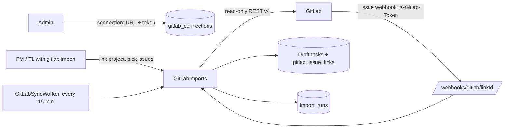

# GitLab Integration

Status: **Approved (Phase 10, 2026-10-18)**

GitLab is an **integration source only**: the application reads projects and issues through the GitLab REST API v4 and never writes to GitLab (A14). Requirements: FR-IMP-01..09, AC-IMP-1..2, task-workflow.md §8, security.md S13/S18/S19. Endpoints: api-design.md §4.11.

## 1. Overview

| Piece | Where |
|---|---|
| Entities `GitLabConnection`, `GitLabProjectLink`, `GitLabIssueLink`, `ImportRun` | `src/TaskManagement.Domain/GitLab/GitLab.cs` |
| Connections (Admin) | `src/TaskManagement.Application/GitLab/GitLabConnections.cs` |
| Linking, import, sync, webhook, accepting changes | `src/TaskManagement.Application/GitLab/GitLabImports.cs` |
| `IGitLabClient`, URL rules (`GitLabUrls`), `GitLabOptions` | `src/TaskManagement.Application/GitLab/GitLabClient.cs` |
| HTTP client (retries, SSRF guard) | `src/TaskManagement.Infrastructure/GitLab/GitLabHttpClient.cs` |
| Scheduled sync | `src/TaskManagement.Infrastructure/GitLab/GitLabSyncWorker.cs` |
| Endpoints | `src/TaskManagement.Api/Endpoints/GitLabEndpoints.cs` |
| Angular | `frontend/src/app/features/gitlab/` — **Admin → GitLab** (connections) and the **GitLab** section of a project page |

## 2. Connections (FR-IMP-01/02)

- Only members with `gitlab.connections.manage` (Admin) can add, edit, test or delete a connection: a name, a base URL (gitlab.com or self-managed, also under a sub-path) and a personal, group or project access token with the **`read_api`** scope only.
- The token is encrypted with ASP.NET Core Data Protection (the same key ring as sign-in cookies, kept outside the database — `DataProtection__KeysPath`) and stored as ciphertext. The API never returns it; the UI shows only its last four characters (`…abcd`). Editing a connection replaces the token only when a new one is entered. **If the key ring is lost, every token must be entered again.**
- **Test** calls `GET /api/v4/user` and records *Healthy* / *Unhealthy* with a short, secret-free error.
- A connection cannot be deleted while projects or tasks are linked to it.

## 3. Linking a project and importing issues (FR-IMP-03..05)

1. A PM or TL with `gitlab.import` in the project opens the project's **GitLab** section, picks a connection and searches the GitLab projects the token can see.
2. Linking reads the GitLab project first, so a wrong ID or token is caught at once. One internal project links to one GitLab project; choosing another one replaces the link.
3. The issue list (opened / closed / all, with search) marks issues that are already imported, with their task key.
4. **Import** (1–100 issues at a time) creates one **Draft** task per open issue:

| GitLab | Task |
|---|---|
| Title | Title (control characters dropped, length capped; empty → "GitLab issue #iid") |
| Description | Description, stored and shown as **plain text**, never as HTML (control characters dropped, length capped) |
| Labels | Labels (normalized, at most the task maximum); a `bug` label makes the type *Bug*, otherwise *Feature* |
| Milestone due date | Due date, only if it is not in the past |
| Web URL | Link on the task page |
| Assignees | **Not mapped** (Q10) — the TL assigns as usual |

   Priority is Medium; "algorithm required" and the default checklist come from the project, as for any new task.
- Import is refused unless the project is active and has an active TL or PM (who will receive GitLab notifications).
- **Idempotent (FR-IMP-04, AC-IMP-1):** an issue is identified by (connection, GitLab project ID, issue IID), which is unique in the database. Importing it again only refreshes the link (counted as *updated*); closed issues that were never imported are *skipped*.

## 4. Keeping tasks in step (FR-IMP-06/07, task-workflow.md §8)

A sync re-reads every linked issue (in batches of 100 IIDs). It runs:

- on a schedule — `GitLabSyncWorker`, every `GitLab:SyncInterval` (default 15 minutes) for each link with sync on; each project in its own scope so one failing project does not stop the others; each run appears on **Admin → System status** as job `gitlab-sync`;
- on demand — **Sync now** on the project page;
- from a webhook (optional, see §5) — for that one issue.

| GitLab change | Effect on the task |
|---|---|
| Title / description changed, task is **Draft** | Task updated directly. |
| Title / description changed, task has left Draft (not Closed/Cancelled) | Stored as *pending GitLab changes*; the task page shows them and a member with `tasks.update` can **Accept** (`POST /tasks/{id}/gitlab/accept-changes`). |
| Issue **closed** | Flag *GitLab issue closed* + notification to the project's Team Leaders and PMs. **The task's state is never changed (FR-IMP-07, AC-IMP-2).** |
| Issue reopened | Flag cleared. |
| Issue moved or deleted (edge case 29) | Link marked *missing* + one notification; the task is kept as it is. |

Unlinking a project stops syncing; imported tasks keep their GitLab link (and URL).

## 5. Webhook (optional)

1. On the project's GitLab section, **Generate webhook secret** shows a random 256-bit secret **once** and the path `/api/v1/webhooks/gitlab/{linkId}`. Only its SHA-256 hash is stored; generating a new one replaces the old.
2. In GitLab: *Settings → Webhooks*, URL `https://<app host>/api/v1/webhooks/gitlab/{linkId}`, *Secret token* = the secret, trigger **Issues events** only, SSL verification on.

The endpoint is anonymous (no cookie, no XSRF) and rate limited to 120 requests per minute per IP. The `X-Gitlab-Token` header is hashed and compared in constant time; an unknown link and a wrong secret both answer 404. The payload is used **only** to learn which issue changed (`object_kind = issue`, `object_attributes.iid`); the issue is then re-read from the GitLab API, so a forged payload cannot change data (S18). Payloads over 1 MB and non-issue events are ignored (204).

## 6. Failures, retries and run history (FR-IMP-08/09)

- Every import, sync and webhook sync is recorded as an **import run**: kind, who started it (none for scheduled syncs and webhooks), start/finish, counts created / updated / skipped / failed, and up to 50 error messages. The project page shows the last 20. An audit entry (`gitlab.imported` / `gitlab.synced`) is written for each run; linking, unlinking, new webhook secrets, imported tasks and accepted changes are audited too.
- The HTTP client sends the token only in the `PRIVATE-TOKEN` header (never in a URL), times out after 30 seconds, and makes up to **3 attempts** for 429 and 5xx answers and network errors, honouring `Retry-After` (at most 30 seconds' wait).
- A GitLab failure becomes a **502** problem response with a safe message (`gitlab.unauthorized`, `gitlab.notfound`, `gitlab.ratelimited`, `gitlab.unavailable`) on the GitLab endpoints only; the rest of the application is unaffected. Error messages never contain the token.

## 7. Security (S13, S18, S19)

| Concern | Control |
|---|---|
| Token leakage | Encrypted at rest; write-only in the API; header only; log redaction of `token`; never in audit entries or run errors. |
| SSRF through the base URL | Only Admins set it. Must be an absolute `https` URL without user info, query or fragment. Link-local (169.254.0.0/16, incl. cloud metadata), unspecified, multicast and reserved addresses are refused, and loopback is refused unless allow-listed. The check runs on save **and again on every connection** (custom `ConnectCallback`), so DNS changes cannot bypass it. Redirects are not followed. Private networks are allowed because self-managed GitLab usually lives there. |
| Forged webhooks | Per-link secret, hash + constant-time comparison, payload only a trigger, rate limit. |
| Imported content | Stored and shown as plain text (Angular escapes it); no HTML from GitLab is rendered. |
| Permissions | `gitlab.connections.manage` (Admin, global); `gitlab.import` (PM/TL, per project); accepting changes needs `tasks.update`. Projects the member cannot see answer 404. |

## 8. Configuration

| Setting | Default | Meaning |
|---|---|---|
| `GitLab__SyncInterval` | `00:15:00` | Scheduled sync period. |
| `GitLab__SyncWorkerEnabled` | `true` | Turns the scheduled sync off (the integration tests do). |
| `GitLab__AllowedInsecureHosts__0..n` | none | Hosts that may use plain `http` or a loopback address. **Development and tests only** (the e2e suite allows `127.0.0.1` for its fake GitLab); leave empty in production. |
| `DataProtection__KeysPath` / `__CertificatePath` | see deployment.md §5 | Key ring that also encrypts GitLab tokens. |

## 9. Tests

| Level | What |
|---|---|
| Domain | Issue-link state changes, pending changes, run counters and error cap, token hint. |
| Application | URL normalization and blocked addresses (`GitLabUrlsTests`). |
| Integration | Against `FakeGitLab` (an in-process GitLab API): connections (token never returned, test, delete refused while linked), permissions and 404s, link/import/re-import (AC-IMP-1), closed → flag + TL notice with the state unchanged (AC-IMP-2), reopen, missing issue, Draft vs. pending changes and accept, webhook secret checks, retries on 429/5xx, failures recorded on runs, the scheduled worker, and the SSRF guard on connect (`GitLabConnectGuardTests`). |
| End-to-end | `e2e/tests/gitlab-import.spec.ts`: an Admin adds and tests a connection to a fake GitLab (the token is never shown again), a PM links a project and imports an issue as a Draft task, the imported issue cannot be selected again, and after the issue is closed in GitLab, **Sync now** flags the task while it stays Draft. |

Not tested here: a real GitLab instance (no network access to one from CI). Run the e2e journey once against a real GitLab (a test project and a `read_api` token) in the Testing environment before production.
