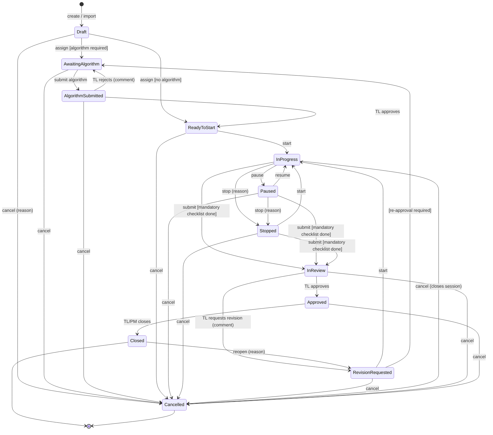
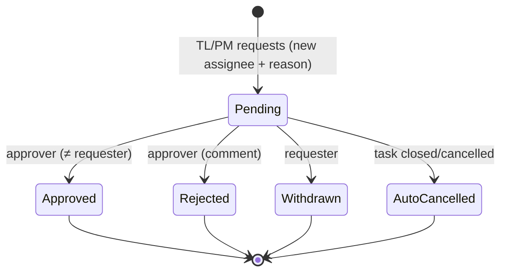

# Task Workflow

Status: **Approved (Phase 1) — recommended defaults accepted 2026-10-17**
Last updated: 2026-10-17

This document defines the task states, the actions that move a task between them, who may perform each action, and what the server checks. The backend implements this as a single state machine in the domain layer, so the rules exist in one place (FR-TASK-05).

## 1. Task states

| State | Meaning |
|---|---|
| **Draft** | Created (or imported from GitLab), not yet assigned. |
| **Awaiting algorithm** | Assigned; algorithm required but not yet submitted (or it was rejected). |
| **Algorithm submitted** | Algorithm waiting for TL decision. |
| **Ready to start** | Assigned and allowed to start (algorithm approved or not required). |
| **In progress** | The assignee has an active work session. |
| **Paused** | Short break; no active session. |
| **Stopped** | Work halted (end of day, blocked); no active session. |
| **In review** | Submitted; waiting for TL review. No work sessions allowed. |
| **Revision requested** | TL sent the task back. Revision number increased. |
| **Approved** | TL approved the current revision. Waiting for final closure. |
| **Closed** | Final. Read-only. Can only be reopened (new revision). |
| **Cancelled** | Final. Read-only. Requires a reason. |

**Flags** (shown alongside the state, not separate states): *Overdue*, *Over allocated hours*, *GitLab issue closed*, *Extension pending*, *Reassignment pending*, *Delay reported*.

## 2. State diagram



(If the per-project "close on approval" option is on — see Q2 — the TL's approval moves the task directly from In review to Closed.)

## 3. Transition rules

"Actor" is the permission required plus the scope check. All actions also require the member to be active and the project not archived.

| # | Action | From | To | Actor | Server checks / side effects |
|---|---|---|---|---|---|
| T1 | Create | — | Draft | `tasks.create` (P) | Project exists, active, has TL/PM. Checklist template copied. Revision = 0. |
| T2 | Assign | Draft | Awaiting algorithm / Ready to start | `tasks.assign` (P) | Assignee is active project member with `tasks.work`. Due date set; allocated hours optional (see WQ1). Assignment history row. Notify assignee + TL. |
| T3 | Submit algorithm | Awaiting algorithm | Algorithm submitted | Assignee, `algorithms.submit` (O) | Non-empty content. New immutable version. Notify project TL(s). |
| T4 | Approve algorithm | Algorithm submitted | Ready to start | `algorithms.approve` (P) | Approver ≠ assignee. Notify assignee. |
| T5 | Reject algorithm | Algorithm submitted | Awaiting algorithm | `algorithms.approve` (P) | Comment required. Approver ≠ assignee. Notify assignee. |
| T6 | Start | Ready to start, Stopped, Revision requested | In progress | Assignee, `tasks.work` (O) | No active session for this member (any task) or this task. Creates session with server time. Idempotent. |
| T7 | Pause | In progress | Paused | Assignee | Closes active session (end reason Paused). Reason optional (setting). |
| T8 | Resume | Paused | In progress | Assignee | Same checks as Start. New session. |
| T9 | Stop | In progress, Paused | Stopped | Assignee | Reason required. Closes active session if any (end reason Stopped). |
| T10 | Submit for review | In progress, Paused, Stopped | In review | Assignee, `tasks.submit` (O) | All mandatory checklist items complete. Summary required. Closes active session (end reason Submitted). No pending reassignment. Notify TL(s). |
| T11 | Approve review | In review | Approved (or Closed if close-on-approval) | `tasks.review` (P) | Reviewer ≠ assignee. Notify assignee, PM. |
| T12 | Request revision | In review | Revision requested (or Awaiting algorithm if re-approval required) | `tasks.review` (P) | Comment required. Reviewer selects checklist items to reopen. Revision += 1. Allocated-hour notification flags reset for the new revision (see WQ2). Notify assignee. |
| T13 | Close | Approved | Closed | `tasks.close` (P) | Approval exists for the **current** revision. Pending requests auto-cancelled. Notify assignee, TL. |
| T14 | Reopen | Closed | Revision requested | `tasks.reopen` (P) | Reason required. Revision += 1. Notify assignee, TL. |
| T15 | Cancel | any non-final | Cancelled | `tasks.cancel` (P) | Reason required. Closes active session (end reason Cancelled). Pending requests auto-cancelled. |
| T16 | Edit fields | any except Closed/Cancelled | (same) | `tasks.update` (P) | Optimistic concurrency. Due date not editable after assignment (use extension). "Algorithm required" editable only before first Start. |

Any action not listed for the current state is rejected with **409 Conflict** and a message naming the current state and allowed actions.

## 4. Work-session rules

```mermaid
sequenceDiagram
    participant Dev as Developer (Angular)
    participant API as API
    participant DB as PostgreSQL
    Dev->>API: POST /tasks/{id}/start (Idempotency-Key)
    API->>API: Check permission, assignee, state = Ready/Stopped/Revision
    API->>DB: BEGIN; INSERT work_session(started_at = now() UTC); UPDATE task status; INSERT audit + outbox; COMMIT
    DB-->>API: unique index violation? → 409 "active session exists"
    API-->>Dev: 200 session + task state
```

1. Only the database's clock (`now()` in UTC) is used for start and end times.
2. Two partial unique indexes guarantee: one active session per member, one active session per task.
3. Start/Resume/Pause/Stop accept an `Idempotency-Key` header; a repeated key returns the original result.
4. A member with an active session on task A who tries to start task B gets **409** ("Pause or stop TMA-12 first"). *(Alternative: auto-pause A. Default: reject.)*
5. Session end reasons: Paused, Stopped, Submitted, Reassigned, Cancelled, Auto-closed, Member deactivated.
6. Background job every minute:
   - Auto-close sessions longer than the max session length (default 10 h).
   - Recompute time for tasks with active sessions and send the 80 % and 100 % allocated-hour notifications, each **once per revision** (tracked by flags on the task).
7. Time corrections are separate adjustment records (+/− minutes, reason, author). Sessions themselves are never edited.

## 5. Reassignment flow



- Allowed when the task is in: Awaiting algorithm, Algorithm submitted, Ready to start, In progress, Paused, Stopped, Revision requested. **Not** allowed in Draft (use Assign), In review, Approved, Closed, Cancelled.
- One pending request per task.
- On approval: the old assignee's active session closes (end reason Reassigned); assignment history row is written; new state:
  - Awaiting algorithm — if the approver marks "algorithm re-approval required", or no algorithm was approved yet and one is required.
  - Ready to start — if the task had not started yet.
  - Stopped — if work had already started (the new assignee presses Start).
- Old and new assignee, TL(s) and PM(s) are notified.

## 6. Deadline extension flow

Same request lifecycle as reassignment (Pending → Approved / Rejected / Withdrawn / AutoCancelled).

- Requester: assignee (O) or TL/PM (P). Fields: proposed due date (must be later than current due date and not in the past), reason.
- Approver (≠ requester) may approve with the proposed date or a different date, or reject with a comment.
- On approval: task due date changes; original due date stays stored; extension history row; Overdue flag recalculated.
- One pending extension per task.

## 7. Delay reports and overdue

- Delay report: category + description, by the assignee, any open state. Does not change state or due date. Notifies TL/PM.
- Daily job (and on due-date change) sets/clears the *Overdue* flag for tasks past due that are not Approved/Closed/Cancelled. Notifies assignee and TL once per day while overdue (configurable).
- *Due soon* notification sent once, a configurable time (default 24 h) before the due date.

## 8. GitLab-linked tasks

- Imported issues create tasks in **Draft**.
- Sync updates title/description only while the task is Draft (after that, changes are shown as "GitLab changed" for the TL to accept — keeps the internal record stable).
- GitLab issue closed → flag *GitLab issue closed* + notify TL. **Task state is never changed by GitLab** (mandatory rule).
- GitLab issue reopened → flag cleared.

## 9. Workflow decisions

Defaults accepted on 2026-10-17 (see [requirements.md](requirements.md) §5).

| ID | Question | Default |
|---|---|---|
| WQ1 | Must due date and allocated hours be set before assignment, or can they be empty? | Due date required; allocated hours optional ("not estimated"). |
| WQ2 | On a revision, do allocated hours notifications compare against total time across all revisions, or time in the current revision only? | Total across all revisions vs current allocation; TL can increase the allocation. Notification flags reset on a new revision and when the allocation changes (so an already-exceeded task notifies again once at the start of a revision). |
| WQ3 | Starting task B while A is active: reject (default) or auto-pause A? | Reject. |
| WQ4 | Should PM be able to send an Approved task back to the TL instead of closing it? | Not in first release; PM can ask TL to reopen after closing. |
